# Executive Summary  
Produce a focused implementation prompt and 2‑hour plan for MiMo 2.6 Flash. The agent must **render the approved ChartDocument as a static ChartBoard** matching `panchavati-compv3.html` exactly, with no redesign. The prompt will list precise acceptance criteria (layout parity, responsiveness, Marathi text, no overflow) and required API calls. A detailed timeline with checkpoints and a shortlist of FreeBuff skills guides MiMo’s execution. Finally, a short human-review checklist ensures the output meets expectations.

## MiMo Implementation Prompt  
```
You have 2 hours and must implement Slice 1: a React 19 + Vite + Tailwind app that **renders the Panchavati duty chart from ChartDocument JSON**. 

**Inputs:** Only use the provided files. Read *docs/New_Claude_Plan.md*, *docs/PRODUCT_UI_ARCHITECTURE.md*, *docs/CURRENT_STATE.md*, *docs/OPEN_QUESTIONS.md*, *skills/*, *design/panchavati-compv3.html*, *design/compv3.css*, *src/types/chart-document.ts*, *scripts/render-chart.ts*, *server/render/chart-html.ts* for information. Inspect Arjish’s and Kushal’s repos (DailyDutyPanchavati-ui-rebuild) for patterns if accessible, but do not copy their designs. Do not modify server DB or migrations, and do not generate new HTML prototypes. Your goal is a **read-only ChartBoard** mirroring the compv3 design, loaded from ChartDocument data.

**Technical Requirements:**  
- **Data:** Fetch `ChartDocument` via GET `/api/charts/:date` or `/api/charts/:date/document`. Use date=2026-09-10 as default. If no API, load `tests/fixtures/2026-09-10.chart-document.json`. Do not hardcode chart data.  
- **UI:** Reproduce `panchavati-compv3.html` exactly in React/Tailwind. All Marathi text, fonts, colors, borders, and spacings must match. The layout must have four equal columns on desktop, wrapping at mobile breakpoints. Section headings, officer cards, and tables must align with the mock.  
- **Responsiveness:** At ≥1024px wide, all tables are four columns (no overflow). At 390px, show one-column stacking of all sections (no truncation).  
- **Visual Checks:** Marathi labels and Devanagari digits must render correctly (no Latin digits). No text should overflow or wrap strangely. Sections titled (दिनांक, वरिष्ठ पोलीस निरीक्षक, चौकी etc.) must appear in the same order, with “DRAFT” watermark in top-right of header.  
- **Interactivity:** The app is initially view-only. Do not implement edit or save. You may include a non-functional edit-mode toggle button, but no editing. The navbar and date heading should be present (clickable **”दिनांक:”** may open a calendar later but can be dummy now).  
- **Acceptance Tests:** Verify the final output by screenshot comparison to `compv3.html`: identical geometry and fonts (titles centered, badges removed, 4×258px columns on page-1). Breakpoints tested at 768px and 390px. Use console checks for no errors.  
- **API:** The only needed endpoints are `GET /api/charts/:date` and/or `GET /api/charts/:date/document` returning the full `ChartDocument` JSON (fields from *src/types/chart-document.ts*). You may simulate them with the JSON fixture. No other endpoints should be required in Slice 1.

**Important:** *Follow the existing design exactly – do NOT redesign or alter it.* Report any blocker immediately (e.g. missing files or APIs) rather than guessing.

```

## 2-Hour Execution Timeline  

```mermaid
gantt
    title 2-Hour Plan (minutes)
    dateFormat  mm
    axisFormat %M
    section Tasks
    Inspect Files and Types     :done,    0,   10
    Scaffold React+Vite Project :done,   10,   15
    Implement ChartBoard Layout :active, 25,   45
    Add Navbar/Date/Responsive   :        70,   30
    Verify & Fix Issues         :crit,  100,   20
```  


- **0–10:** *Setup and inspection.* Ensure all required files are accessible. Confirm `ChartDocument` type shape. Identify key UI components from compv3.  
- **10–25:** *Scaffold.* Initialize Vite + React 19 + TypeScript + Tailwind project. Install needed dependencies. Create basic file structure (`App`, `ChartBoard`, etc.).  
- **25–70:** *Render chart content.* Write components to match each section of `compv3.html` (header, officer row, duty tables, sign-off). Use the fetched JSON to fill data. Ensure exact column widths and text styles.  
- **70–100:** *UI Shell and responsiveness.* Add a top navbar (Home, Today, etc.) and date heading. Make the grid responsive: 4 columns ≥1024px, collapse to 1 column ≤390px. Include a dummy “Edit” toggle or Date picker placeholder if easily done.  
- **100–120:** *Verification.* Run browser and unit tests. Compare output to compv3 mock (pixel match or manual). Fix any overflow, alignment or formatting issues. Ensure no console errors. Freeze the code at 2h with what's done.

At each checkpoint, if blocked (missing file, unclear spec, error), **stop** and report the blocker instead of proceeding.

## FreeBuff Skills to Enable  
- **`vercel-react-best-practices`** – Ensure React + Vite project follows idiomatic structure and performance guidelines.  
- **`tailwind-design-system`** – Enforce consistent use of Tailwind utilities for layout and styling per the design system.  
- **`anthropics/frontend-design`** – Check UI layout and typography match the approved mock.  
- **`obra/verification-before-completion`** – Guide writing tests or checks to verify layout and behavior before claiming success.  
- **`obra/test-driven-development`** – Encourage incremental testing (e.g. rendering small components to JSON) as components are built.  
- **`addyosmani/accessibility`** – Flag any obvious a11y issues (color contrast, semantic elements) even in this slice.  
- **`anthropics/agent-browser`** – Use to open and inspect the provided HTML/CSS and ChartDocument schema files.  
- **`wshobson/react-hook-faux`** (if available) – Quick suggestions for implementing simple React hooks or state patterns.

## Prompting Tips for MiMo (FreeBuff)  
- **Use plan vs execute modes:** In Claude, use `/model opusplan` for initial plan and Shift+Tab to switch to Sonnet for coding. Frame requests clearly.  
- **Avoid loops:** If unsure, explicitly ask for clarification. Do not retry indefinitely – pivot to error handling or note the issue.  
- **Read files explicitly:** Use agent-browser to open a file if needed. If a requested file is missing, return a clear error message (e.g. “File not found”).  
- **Token saving:** Focus responses to only the requested output. Use short variable names internally. Only retrieve needed data (e.g. use limited ChartDocument fields).  
- **Describe blockers clearly:** If an API call fails, or design spec is ambiguous, report “BLOCKED: [issue]” with details. Do not guess.  
- **Progress updates:** Indicate major milestones (scaffold done, chart rendered, etc.) to checkpoint against the timeline.  

*Sources: Best practices from Claude Code tips and general agent prompting guidelines.*

## Human-Review Checklist  
1. **Visual Fidelity:** Rendered chart matches `panchavati-compv3.html` exactly (text, fonts, alignment, section order). No resizing or missing pieces.  
2. **Responsive:** At ≥1024px width, all 4 columns appear; at ≤390px, content stacks vertically without horizontal scroll.  
3. **Data Source:** Chart data comes from API/JSON, not hardcoded. The sample 2026-09-10 data should be loaded (no “dummy” values).  
4. **Interactivity:** Only allowed static actions (e.g. non-functional Edit button). No editing forms or new content added.  
5. **No Errors:** Console and build logs are clean. No unresolved references or crashes.  
6. **Code Quality:** Uses React/Tailwind idiomatically per enabled skills. Components are reusable and cleanly structured.  
7. **Device/emulator test:** Confirm the app opens without issues, and window.print on the chart yields a valid page (for later PDF test).  
8. **Acceptance met:** All listed criteria in the prompt are satisfied. If any fail, note them before moving to Slice 2.

# 1. Repository and Legacy Audit  

The **new repo** already contains the frozen compact chart design (`panchavati-compv3.html`, `compv3.css`) and a skeleton backend (Fastify/Kysely). We will *preserve* this approved design exactly – it is our print contract. No redesign of layout or style should occur. Instead, every interactive element must fit into the existing chart structure (for example, edit controls overlay or replace text in-place, but the overall table/grid remains identical).  

The old references are **implementation patterns** only:  
- The **Arjish repo** had a React-based version of the compact chart (an earlier “compact-v2” variant) and included similar components (chowki blocks, officer cards, etc.). We should scan it for reusable ideas (e.g. how it generated four equal-width tables per row), but *not* carry over its rigid page-specific logic or duplicated domain schemas. Notably, Arjish’s code had duplicated chowki vs. page-1 tables (the legacy “two parallel models” issue) – we must avoid that by using a single unified data model.  
- The **Kushal repo** (archive) had working CRUD UIs for staff and chart editing. Useful patterns include staff search/dropdowns, “Add new” flows, and date navigation logic. We should leverage these UI/interaction patterns but adapt them to our cleaner backend. For example, if Kushal’s UI had a “quick add staff” dialog, we can reuse that component’s behavior. (If any code files from these repos can be legally referenced, they are in our `/archive` folder; otherwise use them only as a functional reference.)  

**Reuse opportunities:** Each legacy repo may contain tested code for: person-selection popovers, calendar pickers, table layouts, data seed fixtures, etc. Identify and extract those components or algorithms when possible. For instance, if the Arjish code used a React grid or Tailwind classes for the 4-column layout, we should replicate that approach since it already matched the visual spec. If the Kushal repo had a robust staff data model with Prisma or similar, we can examine its schema for good ideas.  

**Discarded patterns:** Anything tied to the *6-page old Panchavati* (page-specific overrides tables, obsolete table structures, WhatsApp/OCR, etc.) should be dropped. Also avoid any hardcoded “ghost data” or placeholder logic that was only for prototypes. Our system will be brand-new: all chart data comes from the database, not from static markup.  

# 2. UI Component Breakdown and Pixel-level Design  

The compact chart divides into a header and several grid/table sections. We will implement it in React+Tailwind to match the static HTML. The key components and layout rules are:

- **Chart Header (`ChartHeader`)**: Contains the station title, “दैनिक कर्तव्य वाटप”, date, day-of-week, and DRAFT badge. Layout: a three-column grid (`1fr auto 1fr`) after dropping the removed left logo. We fix the title to center (e.g. `col-start:2 / col-end:3`) so it stays in middle when logo is gone. Use Tailwind classes like `grid grid-cols-[1fr_auto_1fr]`. *Typography:* main title ~13px semibold (per audits), date ~11.5px, all text in Devanagari. Colors: black text; DRAFT badge right-aligned. (This exact layout ensures the header text is centered and balanced.)  

- **Senior Officers Row (`SrOfficerRow`)**: Below header are badges for senior officers (e.g. “वपोनि: …”). Each is a small box. We should create a component `OfficerBlock` for these, with props for title (“वपोनि”), name, and subrole. In React/Tailwind, we can use something like `<div class="flex flex-col items-center text-center">…</div>`. Ensure the title (label) is semibold or bold, name below in regular weight. Use the approved spacing: officers appear side-by-side horizontally (e.g. flex row with equal spacing). On narrow screens, this could wrap or stack (we saw no wrap tests failing, so it likely stacks at mobile).

- **Main Tables Grid**: The core is the 4-side-by-side tables on page 1 (“दिवस पाळी”, “रात्र पाळी”, “कार्यालयीन”, “कोर्ट”). According to the HTML mock, these four tables must be exactly equal-width columns with no extra space. In Tailwind, we use a grid: e.g.  
  ```html
  <div class="grid grid-cols-4 gap-4">
    <div><!-- दिवस पाळी table --></div>
    <div><!-- रात्र पाळी --></div>
    <div><!-- कार्यालयीन --></div>
    <div><!-- कोर्ट --></div>
  </div>
  ```  
  The above will produce four equal columns. We measured each cell to be ~258px in the audit. Ensure to set a suitable gap (perhaps `gap-4` or exact margin) so the total width fits A4. For responsive design, at <768px we should collapse to one column (Tailwind `grid-cols-1 md:grid-cols-4` or similar). Within each table, wrap long text (e.g. person names) so lines break cleanly. Use Tailwind’s text and whitespace classes (e.g. `whitespace-normal`).

- **Table Headers and Text**: The tables use a multi-level heading system (sections like “चौकी-बाधित उपस्थिती” with horizontal rules, etc.). We must exactly replicate the approved typography sizes: e.g. section heading ~13px semibold, table title ~12.5px semibold, row labels ~10.5px medium (500), values ~11.5px normal. (These values come from the design audit note that values are 11.5px/600 weight.) In React, we can enforce these by Tailwind classes like `text-[11.5px] font-medium`. Avoid defaults like all 12px; use the custom font sizes shown in compv3.css. All text is black on white. Bold/semibold usage must match the design: e.g. only headings and officer titles are semibold, names and data are normal weight (we noted “values never bold” in the audit).  

- **Section Badges/Labels**: Small corner badges (like “पृष्ठ 1”) have been removed from the final design (audit point ④). We will not include them. Dividers between sections should use the existing single black border (remove any double-border as fixed earlier). Any em-dashes in headings were replaced by colons (audit fix ③) – use the updated Marathi text. For example, “सुरक्षित नाशिक: गस्त व स्कॅनिंग वेळापत्रक” is used, with a colon, per CSS fix.  

- **Chowki Blocks (pages 2–5)**: Each chowki (“कारंजा”, “फुले नगर”, etc.) has its own sub-blocks for day/night shifts, with their marshal and bima rows. We will create a `ChowkiBlock` component. In React, use `<table>` or CSS grid to replicate layout. The styling (shaded backgrounds for chowki names, bold lines, etc.) should exactly match compv3.css. If possible, reuse the same Tailwind classes or inline styles from compv3. For responsiveness, these chowki blocks will stack on narrow screens (we saw mobile tests still show all info).  

- **Footer and Signoff**: The bottom “हजेरी लेखनिक / तपासणी अधिकारी / ठाणे शिक्का” block should be centered. As audit ⑥ fixed it, we use Tailwind (`text-center mx-auto`) to center these three fields horizontally. Keep them in one row (or stacked on mobile). Use smaller text size (about 10px/700 weight, as in mock).

In general, **color and styling**: The chart is grayscale (as noted, printing in greyscale is a requirement to preserve semantics). We should not introduce any new colors. Shaded header backgrounds (if any) should remain the same grey used in compv3. Use one consistent font family (probably a standard serif for Marathi). All margins and padding should be tight to fit on A4.

<!-- Potentially cite design principles: anthropic skill "hero is first thing" to justify the header emphasis. -->

# 3. API & Data Model for the First Edit Flow  

We focus on one “critical path” edit flow: changing a person in a duty slot (e.g. replacing चौकी स.नि.) via the UI. The minimal endpoints needed:  

- **`GET /api/charts/{date}`** – Returns the full `ChartDocument` JSON for that date (all tables/blocks, including staff assignments, chowki statuses, manpower, notes, etc.). This projection is typed (see `ChartDocument` in code) but effectively a read of normalized tables (join tables as needed). Use this to populate the page.  
- **`PATCH /api/charts/{date}/assignments/{assignmentId}`** – Updates one person’s assignment. Payload includes fields like `staffId`, `role`, `isBima`, `isClosed`, etc. Returns the updated assignment. This must enforce locking so that only non-finalized charts can be changed (409 error if finalized). On success, the frontend re-fetches the chart or uses the returned partial data to update the React state.  
- **`POST /api/charts/{date}/staff`** – For “Add new staff quickly” flow. Accepts minimal details (name, rank, number) and returns the new staff ID. Then we immediately do a `PATCH` for the assignment referencing this new ID. The staff form should allow quick entry, then return to the slot.  
- **`PATCH /api/charts/{date}/slots/{chowki}/{shift}`** – If the clerk sets a chowki as “बंद” (closed), send `isClosed: true, chargeTo: otherChowkiId`. The server updates the chowki status in the DB. (If a correction is needed, e.g. sudden duty change, that can either be part of assignment updates or its own ledger entry mutation.)  
- **`POST /api/charts/{date}/copy`** – Triggers the “Copy from previous day” flow. The client passes e.g. `{"fromDate": "2023-10-09"}`, and the server creates a new draft for the target date, copying all assignments and template_version_id, returning the new date’s chart. This is a write that clones the source.  
- **`POST /api/charts/{date}/finalize`** – Marks the chart final. The server snapshots `chart_versions.document_json` = current state (ensuring immutability). After this, all edit endpoints return errors for that date.  
- **`GET /api/charts/{date}/print`** – (Optional for P0) Returns the HTML/PDF of the chart for printing. Initially this can just call the existing server-side HTML renderer on the ChartDocument.  

On the database side, minimal actions: create or update **Postings/Assignments** (with `staff_id`, `is_bima`, etc.), **ChowkiShift** (with `is_closed`, `charge_to`), and possibly **ChangeLog** entries. The typed `ChartDocument` layer will combine them. We do **not** invent extra joins; e.g. BIMA is just a boolean column on the assignment record, not a separate join table. Staff is a simple lookup table with fields (name, rank, number, etc.), seeded from old repo data. We will seed initial master data (staff list, chowkis, ranks) but the clerk can edit via master-data screens (out of this first flow).  

**Transaction Safety:** Each PATCH or POST should be atomic. For example, if changing one officer causes a sudden-change ledger entry, do both in one DB transaction. The server should also enforce that finalized charts (or snapshots) are read-only – for example, by checking a `chart_status` column before any write and returning HTTP 409 on violation.  

# 4. FreeBuff Model, Skills, and Prompt Strategy  

We have **limited time budget** on FreeBuff: 2h with MiMo
 
**Key agent skills to enable:**  
- **agent-browser (vercel-labs/agent-browser):** Allows the agent to open and search code and docs in the repository. We must enable this so the AI can inspect our MDs, component files, etc.  
- **planning-with-files (othmanadi/planning-with-files):** Helps the agent refer to files when planning. Useful for orchestrating multi-file edits or reviews.  
- **frontend-design, web-design-guidelines (anthropics/skills):** These contain UI design best-practices. They will remind the AI to stick to distinctive, non-generic layouts (see guidance like “the hero is first thing”). We should include them so the agent’s React/CSS output stays polished.  
- **tailwind-design-system (wshobson/agents):** Guides on Tailwind-based design. This will help ensure consistent spacing and use of utility classes.  
- **shadcn-ui (google-labs-code/stitch-skills):** If we use or consider ShadCN components, this skill can advise on their usage patterns.  
- **accessibility, performance (addyosmani/web-quality-skills):** To auto-flag any glaring accessibility or performance issues (e.g. missing `alt` text, large images, etc.). Not core to MVP, but worth running in final QA.  
- **vercel-react-best-practices (vercel-labs/agent-skills):** For idiomatic React patterns (e.g. hooks, component structure).  
- **typescript-advanced-types, api-design-principles, prisma-database-setup, supabase-postgres-best-practices:** These help with building a correct, idiomatic backend and DB schema. For example, the Prisma skill can suggest how to define models for our normalized tables.  
- **tdd, test-driven-development, webapp-testing:** These will encourage writing automated tests for our API and UI logic. We should at least plan for unit tests on the ChartDocument logic and maybe a simple Playwright check for the UI.  
- **requesting-code-review, receiving-code-review:** To make the agent produce code in clean, reviewable PR chunks with comments.  
- **existing project skills:** Check the `skills/` folder in the repo (e.g. `skills/source-forensics`, `current-chart-ui`, etc.). If any custom skill was made (the prompt mentioned earlier custom “7 skills”), they likely encode specific tasks (like verifying print fit). These could still help automate checks (e.g. a `print-check` skill). If they exist, we should enable them as well.  

**Prompt Guidelines:** Keep prompts concise and goal-focused. Provide context via file attachments or code blocks rather than long re-statements. Use Mimo’s higher throughput by chunking tasks (ask for one component at a time). For example:  
- *“Using our existing `ChartHeader` component style, generate the JSX/Tailwind for the header layout with Marathi text placeholders.”*  
- On staff picker: *“Implement a StaffPicker popover: on open it fetches `/api/staff`, lists names with search, and has actions to edit or add staff. Provide TypeScript code.”*  

Avoid loops and repetition by designing tasks as single, complete outputs. Use the **verification-before-completion** skill: after generating code, immediately ask it to run lint/type checks (instruct agent to simulate or use a local TypeScript compiler via a skill) and fix any errors. Break tasks into small pieces: define one UI component or API endpoint per prompt, then test/verify it before moving on.  

Also use the **Agent-style annotations**: e.g. start prompts with a system-like instruction (“You are a React developer”) and end with “Make sure the output passes TypeScript type-checks.” This aligns with Claude’s style as in our planning prompt.  

# 5. Next Steps and Division of Labor  

With the planning complete and the model/skill setup decided, we should **start building the UI/React** slice now. The core steps:  
1. **Set up** (P0 done): ensure the repo structure (Fastify server, Vite React client, Tailwind config) is scaffolded.  
2. **Implement Chart components** (our "Slice 1"): translate `panchavati-compv3.html` into React components as outlined above. We should do this in React+TypeScript with Tailwind classes matching compv3.css. For example, create `ChartBoard.tsx` that renders the header, officer row, tables, etc., using our JSON data (initially mocked from the 10/09 sample). Use the NagaAI fact about Tailwind: “grid-cols-4” for the 4-column layout.  
3. **Integrate interactivity**: Add edit-mode toggles (maybe a button to enter “edit mode”). On entering edit mode, each assignment field becomes clickable. For now we can stub these with empty handlers. The key is to verify that the static layout matches exactly before adding behavior.  
4. **Verify print layout**: Use a print-preview tool or the existing Playwright script to confirm that the React-rendered chart still fits as before (657px print extent). This ensures we matched styling precisely.  
5. **Build incremental backend API**: Start with `GET /api/charts/{date}` returning the 10/09 JSON (we can derive it from the semantic MD files or our domain seed). Then test that React can fetch this and render. Next add one mutation, e.g. updating a staff assignment (still stub the UI).  
6. **Master staff picker**: Implement a staff search box and “Add new staff” form. We can reuse patterns from Kushal’s old CRUD (e.g. a modal form).  

Throughout, use tests and incremental commits. For every component or endpoint, write one small test (e.g. a Vitest unit test for a pure function or a Playwright step for a button click). The planning skills (`tdd`, `webapp-testing`) should remind the agent to scaffold tests.  

By the end of Slice 1, we should have *one working round-trip*: fetch the chart JSON, render the UI, click an officer slot, open a StaffPicker, select or create a staff, call an API to update the assignment, and see the UI update (and save to DB). This core flow demonstrates that the architecture works. We can then proceed to the remaining slices (printing, master data, history, etc.) with confidence.

**Sources:** The above choices are backed by model benchmarks (Mimo and GLM contexts) and community observations, Tailwind docs, and our audit findings (see attached MDs and [14]). 

